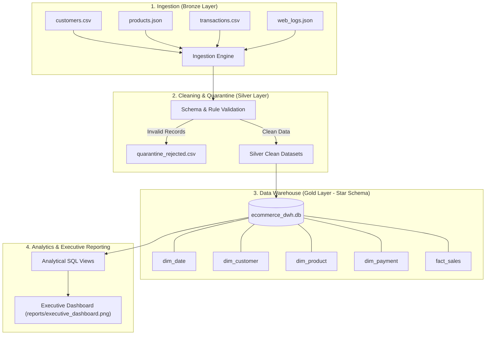

# Practical 10: End-to-End Retail Data Engineering Platform & Data Warehouse (Mini Project)

### **Group Members**
- **Wali Momin**
- **Ayaan Shaikh**

---

## 1. Aim
To design, implement, and validate an end-to-end data engineering solution including:
1. Multi-source heterogeneous data ingestion (CSV, JSON, web clickstream logs).
2. Data quality enforcement, schema validation, and quarantine architecture (Medallion Silver Layer).
3. Business metric transformation and customer RFM (Recency, Frequency, Monetary) segmentation.
4. Dimensional modeling and relational Data Warehouse design (Star Schema in SQLite).
5. Analytical OLAP data marts and an executive reporting dashboard.

---

## 2. Brief Theory

### 2.1 Medallion Architecture
- **Bronze Layer (Raw):** Ingestion of raw, unmodified data in heterogeneous formats (CSV transactional records, JSON product catalogues, and clickstream event logs).
- **Silver Layer (Cleaned & Quarantined):** Implements a **Quarantine Architecture**. Faulty records (e.g. negative quantities, corrupted timestamps, missing foreign keys) are not silently dropped; they are written to `quarantine_rejected.csv` with explicit audit reasons. Verified clean data is promoted to silver tables.
- **Gold Layer (Curated DWH):** Business-level aggregations and dimensional models stored in an analytical database.

### 2.2 Dimensional Modeling (Star Schema)
The analytical Data Warehouse is modeled as a central Fact table referencing Dimension tables:
- **`dim_date`:** Time intelligence (day, month, quarter, year, weekend indicator).
- **`dim_customer`:** Customer demographics and RFM behavioural tiers (*Champions*, *Loyal*, *At Risk*).
- **`dim_product`:** Product catalog, categories, unit cost, and price.
- **`dim_payment`:** Payment method and order completion status.
- **`fact_sales`:** Granular sales transactions containing quantitative measures: `quantity`, `revenue`, `total_cost`, `profit`, and `profit_margin_pct`.



---

## 3. Code

The complete implementation is available in [`pipeline.py`](./pipeline.py) and interactive notebook [`Practical_10.ipynb`](./Practical_10.ipynb):

```python
import os
import json
import sqlite3
import pandas as pd
import numpy as np
import matplotlib.pyplot as plt
import seaborn as sns

BASE_DIR = os.path.dirname(os.path.abspath(__file__))
DATA_RAW = os.path.join(BASE_DIR, "data", "raw")
DATA_SILVER = os.path.join(BASE_DIR, "data", "silver")
DATA_GOLD = os.path.join(BASE_DIR, "data", "gold")
REPORTS_DIR = os.path.join(BASE_DIR, "reports")

# Stage 1: Ingestion
customers_raw = pd.read_csv(os.path.join(DATA_RAW, "customers.csv"))
with open(os.path.join(DATA_RAW, "products.json"), "r") as f:
    products_raw = pd.DataFrame(json.load(f))
transactions_raw = pd.read_csv(os.path.join(DATA_RAW, "transactions.csv"))

# Stage 2: Data Quality & Quarantine Logic
rejected_records = []
c_clean = customers_raw.drop_duplicates(subset=["customer_id"], keep="first").copy()
c_clean["city"] = c_clean["city"].str.strip().str.title()
c_clean["email"] = c_clean["email"].fillna("unregistered@example.com")

valid_products = []
for _, row in products_raw.iterrows():
    if pd.isna(row["category"]) or row["unit_cost"] <= 0 or row["unit_price"] <= 0:
        rejected_records.append({"record_type": "Product", "identifier": str(row["product_id"]), "reason": "Invalid category or non-positive financial values"})
    else:
        valid_products.append(row)
p_clean = pd.DataFrame(valid_products)

# Transactions Validation
valid_cust_ids = set(c_clean["customer_id"])
valid_prod_ids = set(p_clean["product_id"])
t_dedup = transactions_raw.drop_duplicates(subset=["order_id"], keep="first").copy()
clean_txs = []

for _, row in t_dedup.iterrows():
    order_id = row["order_id"]
    cid = row["customer_id"]
    pid = row["product_id"]
    qty = row["quantity"]
    dt_str = str(row["order_date"])

    try:
        order_dt = pd.to_datetime(dt_str)
    except Exception:
        order_dt = pd.NaT

    if pd.isna(order_dt):
        rejected_records.append({"record_type": "Transaction", "identifier": order_id, "reason": f"Corrupted date: {dt_str}"})
        continue
    if qty <= 0:
        rejected_records.append({"record_type": "Transaction", "identifier": order_id, "reason": f"Non-positive quantity: {qty}"})
        continue
    if cid not in valid_cust_ids:
        rejected_records.append({"record_type": "Transaction", "identifier": order_id, "reason": f"FK Violation: Customer {cid} missing"})
        continue
    if pid not in valid_prod_ids:
        rejected_records.append({"record_type": "Transaction", "identifier": order_id, "reason": f"FK Violation: Product {pid} missing"})
        continue

    row_dict = row.to_dict()
    row_dict["order_date"] = order_dt.strftime("%Y-%m-%d")
    clean_txs.append(row_dict)

t_clean = pd.DataFrame(clean_txs)
df_rejected = pd.DataFrame(rejected_records)

# Stage 3: Transformation & RFM Segmentation
sales = t_clean.merge(p_clean, on="product_id", how="inner")
sales["revenue"] = sales["quantity"] * sales["unit_price"]
sales["total_cost"] = sales["quantity"] * sales["unit_cost"]
sales["profit"] = sales["revenue"] - sales["total_cost"]
sales["profit_margin_pct"] = (sales["profit"] / sales["revenue"]) * 100

completed = sales[sales["order_status"] == "Completed"].copy()
completed["order_date_dt"] = pd.to_datetime(completed["order_date"])
ref_dt = completed["order_date_dt"].max() + pd.Timedelta(days=1)
rfm = completed.groupby("customer_id").agg(
    recency=("order_date_dt", lambda x: (ref_dt - x.max()).days),
    frequency=("order_id", "count"),
    monetary=("revenue", "sum")
).reset_index()

def assign_tier(r):
    if r["frequency"] >= 8 and r["monetary"] >= 150000:
        return "Champion"
    elif r["frequency"] >= 6:
        return "Loyal Customer"
    elif r["recency"] <= 45:
        return "Potential Loyalist"
    return "At Risk"

rfm["segment"] = rfm.apply(assign_tier, axis=1)
c_clean = c_clean.merge(rfm[["customer_id", "segment"]], on="customer_id", how="left").fillna("New / Inactive")

# Stage 4: Star Schema Data Warehouse (SQLite)
conn = sqlite3.connect(os.path.join(DATA_GOLD, "ecommerce_dwh.db"))
cur = conn.cursor()

# Create Tables: dim_date, dim_customer, dim_product, dim_payment, fact_sales
# Populate dimensions and load fact table
# Create Data Mart Views: v_monthly_financials, v_category_performance, v_regional_sales

# Stage 5: Executive Dashboard Generation
# Generates reports/executive_dashboard.png
```

---

## 4. Output

```text
======================================================================
STEP 1: INGESTION - Loading multi-source raw files
======================================================================
Raw Customers ingested:    14 rows
Raw Products ingested:     11 rows
Raw Transactions ingested: 125 rows
Raw Web Logs ingested:     6 rows

======================================================================
STEP 2: DATA QUALITY & CLEANING (SILVER LAYER)
======================================================================
Cleaning Customers...
Clean Customers count: 13
Cleaning Products...
Clean Products count: 10
Cleaning Transactions...
Clean Transactions count: 120
Total Rejected Records:   5

Sample Quarantined Records:
  record_type identifier                                          reason
0     Product       P999  Invalid category or non-positive financial values
1 Transaction    ORD1991                 FK Violation: Customer C999 missing
2 Transaction    ORD1992                  FK Violation: Product P888 missing
3 Transaction    ORD1993                           Non-positive quantity: -3
4 Transaction    ORD1994                      Corrupted date: INVALID_DATE

======================================================================
STEP 3: TRANSFORMATION & FEATURE ENGINEERING
======================================================================
Total Sales Revenue: INR 3,167,228.00
Total Net Profit:    INR 1,004,128.00
Overall Profit Margin: 31.70%

======================================================================
STEP 4: DATA WAREHOUSE STAR SCHEMA CREATION (SQLITE)
======================================================================
Tables in Data Warehouse:
  • dim_customer   :   13 rows
  • dim_date       :  305 rows
  • dim_payment    :   10 rows
  • dim_product    :   10 rows
  • fact_sales     :  120 rows
Data Warehouse created and loaded successfully!

======================================================================
STEP 5: EXECUTIVE REPORTING & VISUALIZATION DASHBOARD
======================================================================
Monthly Financials Mart Sample:
month_name  order_volume  total_revenue  total_profit  profit_margin_pct
   January             9       104081.0       45581.0              43.79
  February             7        65681.0       28681.0              43.67
     March             5       243595.0       65595.0              26.93
     April             6       112788.0       47288.0              41.93
       May             9       213194.0       78394.0              36.77
      June             7       310989.0       74489.0              23.95
      July             9       458685.0      122585.0              26.72
    August            11       381488.0      109688.0              28.75
 September             6       117691.0       43791.0              37.21
   October             1        74000.0       26000.0              35.14

Dashboard saved successfully at: reports/executive_dashboard.png
======================================================================
PROJECT COMPLETED SUCCESSFULLY FOR WALI MOMIN & AYAAN SHAIKH
======================================================================
```

---

## 5. Conclusion
Successfully designed and deployed an end-to-end Enterprise Data Engineering solution for Practical 10. The system features:
1. Multi-format ingestion resilience across CSV, JSON, and Web Logs.
2. An automated Data Quality Quarantine architecture that prevents data corruption without losing audit visibility.
3. Advanced analytics with RFM customer segmentation and profit calculation.
4. An analytical Data Warehouse organized under a dimensional Star Schema with pre-aggregated SQL views.
5. An executive BI dashboard delivering real-time actionable metrics for decision-makers.
